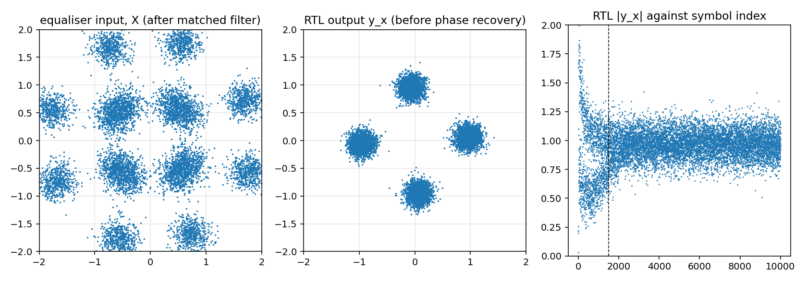

# Dual-Polarisation 2×2 CMA Adaptive Equaliser

SystemVerilog implementation of the constant modulus algorithm (CMA) butterfly
equaliser for a dual-polarisation QPSK coherent optical receiver. It was designed
from the project's Python golden model through a bit-exact integer model, verified
in simulation, and run on the Kria KR260, where it matched the model on every
output.

## Status

| Stage | State |
|---|---|
| Python golden model (float) | complete |
| Fixed-point design and bit-exact integer model | complete |
| RTL, unit-tested module by module | complete, 0 mismatches |
| Full equaliser vs bit-exact model | **10,004 / 10,004 outputs identical** |
| BER of RTL output through BPS and decision | 0 at OSNR 20 dB (same as float model) |
| Implementation, KR260, 100 MHz | **timing met, WNS +1.643 ns** |
| Hardware test on KR260 | **pass: 10,004 outputs, 0 mismatches** |

---

## 1. Function

Polarisation mode dispersion (PMD) in the fibre mixes the two transmitted
polarisations and spreads each symbol into its neighbours. The receiver undoes
this with a 2×2 matrix of FIR filters, the butterfly (Mello & Barbosa, *Digital
Coherent Optical Systems*, Springer 2021, Fig. 5.7; equation numbers below follow its
Section 5.2):

```
y_x = w_xx^H x_x + w_yx^H x_y          book: y1 = w_1V^H x_V + w_1H^H x_H   (5.25)
y_y = w_xy^H x_x + w_yy^H x_y                y2 = w_2V^H x_V + w_2H^H x_H   (5.26)
```

Filter names are *input, output*: `w_yx` takes the y input to output x.

The taps adapt blindly with CMA, which needs no training symbols. QPSK has a
constant modulus, so the algorithm drives |y|² towards R:

```
J = E{(R - |y|^2)^2}                                                  (5.27)
w <- w + mu * (R - |y|^2) * conj(y) * x                               (5.32-5.35)
R = E|s|^4 / E|s|^2 = 1      for unit-power QPSK                      (5.29)
```

CMA ignores phase, so its output keeps an arbitrary rotation and BPS phase
recovery follows it in the receiver chain.

| Book | Python golden model | Hardware |
|---|---|---|
| x[k] = [x[k] ... x[k-N+1]], newest first | `window = input[n-c : n+c+1]`, oldest first | delay line `[0]` = newest, so tap i = Python tap N-1-i |
| y = w^H x | `np.vdot(w, window)` | `cmult` with `CONJ_A = 1` on the tap |
| single-spike start (5.36) | `w_xx[c] = w_yy[c] = 1` | tap reset value 2^22 at the centre |
| T/2-spaced, n = 2k | T-spaced, after `rx = E_matched[::2]` | one update per symbol |
| — | loop starts at n = c (full window) | fill phase: no output or update for the first N-1 samples |

## 2. Design decisions from the golden model

Signal chain from `01_Python/Golden_model/main.py`, reproduced in `model/chain.py`
(seed 2, 10,000 symbols, DGD 0.1 ps/√km, 80 km, 1,500-symbol convergence
discarded, 33,904 bits scored).

**Step size μ = 2⁻¹⁰.** This is a power of two, so the multiply becomes a shift.
The BER matches μ = 10⁻³ to within one or two bit errors:

| OSNR (dB) | N | BER, μ = 1e-3 | BER, μ = 2⁻¹⁰ |
|---|---|---|---|
| 20 | 5 / 21 | 0 / 0 | 0 / 0 |
| 14 | 5 | 1.209e-3 | 1.239e-3 |
| 14 | 21 | 2.271e-3 | 2.242e-3 |
| 12 | 5 | 8.141e-3 | 8.229e-3 |
| 12 | 21 | 1.203e-2 | 1.221e-2 |

**Taps N = 5.** Float model, OSNR 14 dB, BER averaged over seeds 2, 3 and 4:

| N | 3 | 5 | 7 | 9 | 13 | 21 |
|---|---|---|---|---|---|---|
| mean BER | 1.15e-3 | 1.27e-3 | 1.29e-3 | 1.38e-3 | 1.53e-3 | 1.92e-3 |
| DSP48E2 (fully parallel) | 104 | 168 | 232 | 296 | 424 | 680 |

- Mean DGD ≈ 0.1 × √80 ≈ 0.9 ps, under 3 % of the 31.25 ps symbol period, so the
  channel's memory is short.
- 3 to 9 taps are equal within the statistical noise. Beyond that the BER rises,
  because extra taps add gradient noise (excess MSE) without removing more ISI.
- 5 is the smallest choice with ±2 symbols of margin. `N` is a parameter throughout
  the RTL and the models.

## 3. Fixed-point design

`Qm.n`: m integer bits including the sign, n fractional bits. Ranges were measured
with `model/float_ranges.py` (an instrumented copy of the golden model, asserted to
give identical outputs).

| Signal | Bits | Format | Range | Float max seen | Rounding / overflow |
|---|---|---|---|---|---|
| input x | 8 | Q3.5 | ±4 | 2.34 | round, saturate |
| taps w | 24 | Q2.22 | ±2 | 1.0002 | saturate on update |
| product x·w* | 32 | Q5.27 | exact | | — |
| FIR sum | 37 | frac 27 | exact | | — |
| output y | 16 | Q3.13 | ±4 | 2.16 | `(s + 2^13) >>> 14`, saturate |
| \|y\|², R | 33 | Q7.26 | exact; R = 2²⁶ | 5.27 | — |
| error e | 16 | Q4.12 | ±8 | 4.27 | `>>> 14` rounded, saturate |
| g = μ·e·y* | 18 | frac 23 | ±2⁻⁶ | 0.0089 | `>>> 12` rounded (μ included), saturate |
| Δw = g·x | 26 → 24 | frac 28 → 22 | | 0.0226 | `>>> 6` rounded |

- **Rounding is always round-half-up**, `(v + 2^(s-1)) >>> s`, as in the matched filter.
- **Every narrowing saturates.** A wrapped y keeps its size but flips its sign, which
  turns the update around and makes the loop diverge.
- **μ is free.** e·y* has 12 + 13 = 25 fractional bits. Multiplying by 2⁻¹⁰ only moves
  the binary point to 35. Keeping 23 means a shift of 12.
- **The taps need more precision than the data.** The median update is 1.0e-4, so
  updates smaller than half a tap LSB are lost:

| Tap LSB | 2⁻¹² (Q4.12) | 2⁻¹⁴ | 2⁻¹⁸ | 2⁻²² (chosen) |
|---|---|---|---|---|
| updates rounded to zero | 56.0 % | 17.9 % | 1.4 % | 0.1 % |

- **Every multiply fits one DSP48E2 (27 × 18):** taps 24 × 8, squares and e·y* 16 × 16,
  update 18 × 8.

**Bit-exact model.** `model/cma_int.py` implements these formats with integers only,
in the hardware's order (newest sample first, causal, fill phase). Against the float
model it converges identically (`results/cma_int_convergence_N5.png`) and gives
BER 1.298e-3 against 1.239e-3 at OSNR 14 dB. The RMS output difference is 0.009,
which is the 8-bit input quantisation, (1/32)/√12. Feeding the float model the same
rounded input reduces the difference to 6e-5.

## 4. Architecture

```
            ┌──────────── cma_equaliser ─────────────────────────────────────────┐
 x_in ──►   │ delay line x ─┐                                                    │
 y_in ──►   │ delay line y ─┼─► butterfly ─► [y] ─► cma_e1 ─► [e] ─► cma_g1 ─► [g]
            │               │  (4 × complex_fir,                                 │ │
            │               │   product regs)                                    │ │
            │               └──────────────────────► cma_update ◄──────────────────┘
            │                       ▲                    │                       │
            │                       └────── [taps] ◄─────┘   (feedback loop)     │
            └────────────────────────────────────────────────────────────────────┘
```

| Module | Function | DSPs |
|---|---|---|
| `eq_pkg.sv` | all widths, shifts and constants (section 3) | — |
| `cmult.sv` | complex multiply, optional conjugate of the first operand; 4 real multipliers | 4 |
| `complex_fir.sv` | one filter: N `cmult`, product registers, exact sum | 4N |
| `butterfly.sv` | 4 filters, 2 complex adders, round and saturate to y | 16N |
| `cma_error.sv` | `cma_e1`: e = R − \|y\|²; `cma_g1`: g = μ·e·y* | 2 + 2 per output |
| `cma_update.sv` | w + round(g·x) for 4 filters × N taps; output picks g, input picks window | 16N |
| `cma_equaliser.sv` | delay lines, tap registers, stage registers, 6-state controller | — |
| `eq_board_top.sv` | hardware test harness: input ROM, reference ROM, on-chip comparator | — |

**Schedule: K = 6 clocks per symbol.** The controller captures one stage per clock:

| Clock | State | Registered at the end of the clock |
|---|---|---|
| 1 | IDLE | sample shifted into both delay lines (`in_ready = 1`) |
| 2 | MUL | 4N complex products (inside the DSP48E2) |
| 3 | FIR | y: sum, round, saturate |
| 4 | ERR | e = R − \|y\|² |
| 5 | G | g = μ·e·y* |
| 6 | UPD | taps ← taps + Δw; `out_valid = 1` |

The next sample is accepted only after UPD, because the next FIR needs the updated
taps. This preserves the golden model's update-after-every-output behaviour exactly,
which is what makes bit-exact verification possible. Throughput is f_clk / 6.

**Pipelining inside a feedback loop.** A first version with 4 states (FIR and ERR
each done in a single clock) **failed timing at 100 MHz**: WNS −0.664 ns, 1,606
failing endpoints. The FIR path took 10.5 ns (multiply, 20-term add, round) and the
error path 10.6 ns (square, subtract, multiply). Adding a product register and an e
register fixed timing without changing a single output bit. Unlike the matched
filter, where pipeline stages add only latency, every register here is inside the
loop, so each one costs a clock per symbol. Pipelining a loop raises the clock rate
but not the symbol rate.

## 5. Verification

| Level | Model | Criterion | Result |
|---|---|---|---|
| 1 | float golden model | BER vs OSNR, convergence | reference |
| 2 | integer model `cma_int.py` | BER close to level 1 | 44 vs 42 bit errors, OSNR 14 |
| 3 | each RTL module | 0 mismatches vs level-2 vectors | all pass (below) |
| 4 | full `cma_equaliser` | 0 mismatches, every output | 10,004 / 10,004 |
| 5 | RTL output → BPS → decision | BER equal to level 2 | 0 at OSNR 20 |
| 6 | KR260 hardware | 0 mismatches on chip | 10,004 / 10,004 |

| Testbench | Stimulus | Result |
|---|---|---|
| `tb_cmult` | 1,000 random + 5 corner cases, both modes | 0 errors |
| `tb_cma_error` | 300 rows `unit_error.txt` | 0 errors |
| `tb_complex_fir` | 1,200 rows `unit_fir.txt` | 0 errors |
| `tb_butterfly` | 300 rows `unit_butterfly.txt` | 0 errors |
| `tb_cma_update` | 300 rows `unit_update.txt` | 0 errors |
| `tb_eq` | 10,008 symbols `eq_in.txt`, ready/valid driver, separate monitor | 10,004 outputs, 0 mismatches, 60,047 clocks |
| `tb_eq_board` | the hardware harness, clock and reset only | pass = 1, err_count = 0 |

Unit vectors are cut from the full integer-model run by `model/gen_unit_vectors.py`,
which recomputes every row as a consistency check.



*Left: equaliser input, 16 clusters, because each received polarisation carries both
QPSK signals. Middle: RTL output, 4 clusters: the polarisations are separated, with a
45° rotation left for phase recovery. Right: |y| converging from two bands to 1.*

## 6. Implementation results

- Vivado 2026.1, XCK26-SFVC784-2LV-C (Kria KR260 SOM), clock `pl_clk0` = 100 MHz
- N = 5, post-route. Reports are in `results/`.

### Timing (100 MHz)

| Metric | Value |
|---|---|
| WNS (setup) | **+1.643 ns** |
| TNS / failing endpoints | 0.000 ns / 0 of 20,456 |
| WHS (hold) | +0.010 ns |
| THS / failing endpoints | 0.000 ns / 0 of 20,440 |
| WPWS (pulse width) | +4.238 ns |
| Worst path | 7.552 ns: FIR product register → sum → round → y (logic 50 %, routing 50 %, 14 levels) |
| Estimated Fmax | ≈ 120 MHz |

### Utilisation

| Block | LUTs | FFs | DSP48E2 | BRAM |
|---|---|---|---|---|
| `cma_equaliser` (total) | 2,517 | 1,126 | **176** | 0 |
| └ butterfly | 580 | — | 88 | 0 |
| └ cma_e1 × 2 | 121 | — | 4 | 0 |
| └ cma_g1 × 2 | 150 | — | 4 | 0 |
| └ cma_update | 1,617 | — | 80 | 0 |
| test harness ROMs and checker | 12 | 45 | 0 | 46 × RAMB36 + 1 × RAMB18 |
| ILA + VIO + debug hub | 1,756 | 3,113 | 0 | 7 × RAMB36 + 1 × RAMB18 |
| **Device total** | 4,284 (3.7 %) | 4,284 (1.8 %) | 176 (14.1 %) | 54 tiles (37.5 %) |

- DSPs: 168 predicted (80 FIR + 4 + 4 + 80 update). The extra 8 in the butterfly are
  DSP adders Vivado used for part of the FIR sums.
- FFs: the sub-blocks are combinational. The 1,126 FFs are `cma_equaliser`'s own
  registers: mostly the taps (4 filters × 5 taps × 2 × 24 bit = 960) and the delay
  lines (160). The FIR product registers sit inside the DSP48E2s.
- Block RAM is entirely the test harness (two ROMs: 10,008 × 32 bit inputs and
  10,004 × 64 bit references) and the ILA. The equaliser uses none.

### Throughput

| | Value |
|---|---|
| Clocks per symbol | 6 |
| Symbol rate at 100 MHz | 16.7 MBd per polarisation |
| Latency, first sample → first output | 9 clocks (5 fill + 4 stages) |

A 32 GBd system needs about 2,000× this rate. Real receivers process many samples
per clock in parallel blocks, with delayed (block-wise) tap updates. That breaks the
update-every-symbol behaviour this design keeps on purpose for bit-exact
verification.

## 7. Hardware verification

- **Method.** `eq_board_top` plays the 10,008 input symbols from an on-chip ROM
  through the equaliser and compares every output with the `cma_int.py` reference
  held in a second ROM. Reset is released from a VIO, which also reads back the
  result. Procedure: [HARDWARE_TEST.md](HARDWARE_TEST.md).
- **Result.** `done = 1`, `pass = 1`, `out_count = 10004`, `err_count = 0`.
  The KR260 produced exactly the integers of the bit-exact model for every output.
- **Chain of evidence.** float model → integer model (same BER) → RTL (0 / 10,004
  mismatches) → KR260 (0 / 10,004 mismatches).

## 8. Known limitations

- **Singularity is not prevented.** Both outputs adapt from the start, so they can
  converge to the same polarisation. The golden model detects a swap only by
  correlating with the known symbols (simulation only). The book's fix (5.38–5.39) is
  not implemented.
- **The equaliser is tested on its own.** Its input is the Python matched filter
  output rounded to 8 bits, not the hardware matched filter's 18-bit output; that
  interface (rescaling and the ↓2 phase) is not built.
- **One dataset** (seed 2, OSNR 20 dB, DGD 0.1) is verified bit-exactly, at N = 5.
  Vectors for N = 21 exist but were not run in RTL.
- **Throughput is f_clk / 6**, a consequence of keeping exact update-per-symbol
  behaviour (section 6).
- **Fully parallel.** 176 DSPs at N = 5; time-multiplexing could trade throughput for
  far fewer DSPs.
- **The ILA constellation capture** on hardware was not recorded. The on-chip
  comparator result is the hardware evidence.

## 9. Files

| Path | Contents |
|---|---|
| `rtl/` | `eq_pkg`, `cmult`, `complex_fir`, `butterfly`, `cma_error`, `cma_update`, `cma_equaliser`, `eq_board_top` |
| `tb/` | one self-checking testbench per module, `tb_eq` (full design), `tb_eq_board` (hardware harness) |
| `model/chain.py` | `main.py` signal chain and scoring (swap check, BPS, decision, BER) |
| `model/float_ranges.py` | instrumented float equaliser: ranges, μ and tap-precision studies |
| `model/cma_int.py` | bit-exact integer model; writes the test vectors |
| `model/gen_unit_vectors.py` | per-module vectors from the full run |
| `model/make_mem.py` | ROM images for the hardware harness |
| `model/rtl_ber.py` | BER and constellation of the RTL output |
| `model/plot_ila.py` | plots and checks an ILA CSV capture |
| `vectors/N5/` | stimulus, references, unit vectors, ROM images (`N21/`: full-run vectors for 21 taps) |
| `scripts/run_tests.sh` | compiles and runs every testbench in xsim |
| `scripts/build_kr260.tcl` | project, block design, bitstream and reports |
| `scripts/program_kr260_xsdb.tcl` | fallback programming with PS initialisation |
| `results/` | timing and utilisation reports, plots, RTL output, `bitstream/` (bit, ltx, psu_init) |
| `HARDWARE_TEST.md` | step-by-step hardware procedure |
| `archive/initial_drafts/` | first drafts of `cma`, `complex_fir`, `complex_multiplier` (superseded) |

## 10. Reproducing

From `05_FPGA_implementation/Adaptive_equaliser/` in Git Bash:

```
python model/float_ranges.py              # ranges, mu and tap-count evidence (sections 2-3)
python model/cma_int.py                   # integer vs float model, convergence plots
python model/cma_int.py --dump 5          # test vectors for N = 5
python model/gen_unit_vectors.py 5        # unit vectors per module
python model/make_mem.py 5                # ROM images for the hardware test
scripts/run_tests.sh                      # all testbenches: every line must say PASS
python model/rtl_ber.py                   # BER and constellation of the RTL output
/c/AMDDesignTools/2026.1/Vivado/bin/vivado.bat -mode batch -source scripts/build_kr260.tcl
```

The build writes `build/vivado/` (not tracked) and the reports in `results/`.
Check that WNS ≥ 0 in `results/eq_timing.rpt` before using the bitstream.
